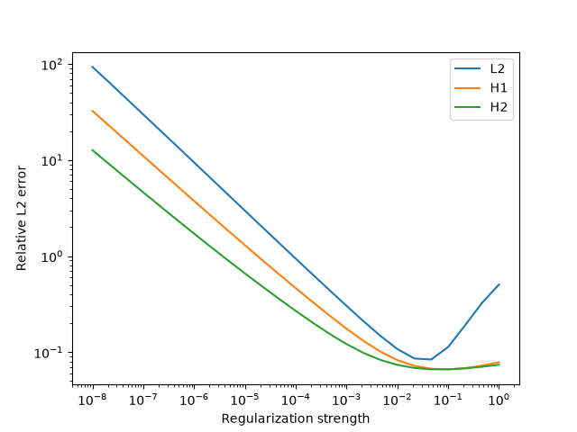
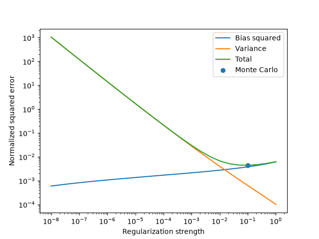
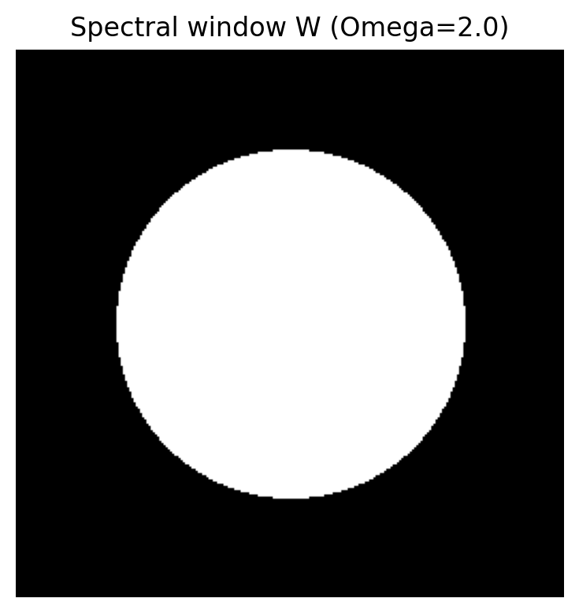
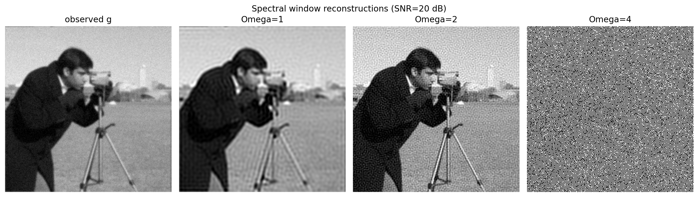
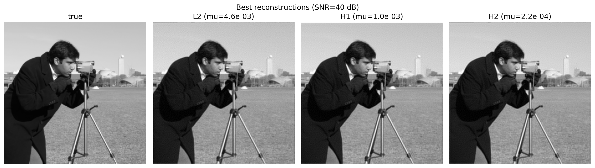
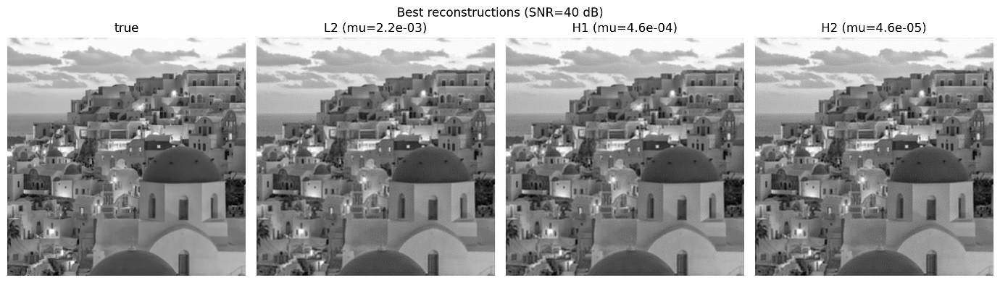

# Spectral Regularization for Image Restoration

A numerical investigation of ill-posed inverse problems, Fourier-domain image restoration and regularization methods.

## Overview

Recovering an image from noisy and blurred observations is an ill-posed inverse problem. Direct inversion amplifies high-frequency noise, making regularization essential for stable reconstructions.

## Mathematical Framework

The forward observation model is

$$
g=Kf+\eta
$$

Generalized Tikhonov regularization solves

$$
f_\mu=\arg\min_f\left(\|Kf-g\|_2^2+\mu\|Pf\|_2^2\right).
$$

In the Fourier domain, the reconstruction becomes

$$
\hat f_\mu=\frac{\overline{\hat K}\hat g}{|\hat K|^2+\mu|\hat P|^2}.
$$

Three regularization penalties are investigated:

| Method | Squared penalty symbol |
|---|---|
| L2 | $1$ |
| H1 | $\lVert\omega\rVert^2$ |
| H2 | $\lVert\omega\rVert^4$ |

Hard spectral cutoff is also implemented as an alternative reconstruction strategy.

## Numerical Experiments

- Gaussian blurring in the Fourier domain
- Additive Gaussian noise at 20 dB and 40 dB SNR
- Parameter sweeps across 25 regularization strengths
- Comparison of L2, H1 and H2 penalties
- Relative reconstruction error analysis
- Analytical bias-variance decomposition
- Monte Carlo validation of expected reconstruction risk

## Reconstruction Results

### 20 dB SNR

### 40 dB SNR

## Regularization Parameter Analysis

The regularization parameter controls the trade-off between reconstruction fidelity and numerical stability.

| 20 dB | 40 dB |
|---|---|
|  |  |

## Bias-Variance Trade-off

The expected squared reconstruction error admits the decomposition

$$
\mathbb{E}\|f_\mu-f\|^2
=
\|\mathbb{E}[f_\mu]-f\|^2
+
\mathbb{E}\|f_\mu-\mathbb{E}[f_\mu]\|^2.
$$

| 20 dB | 40 dB |
|---|---|
|  |  |

## Reproducibility

Experiments use a deterministic synthetic image, seeded noise generation, circular convolution and an angular-frequency grid.

Parameter selection uses known ground truth as an oracle benchmark.

    pip install -r requirements.txt
    python -m pytest -q
    python experiment.py

Generated figures are saved in `results/`.

## Technologies

Python, NumPy, Matplotlib, Fourier analysis, inverse problems and numerical methods.
## Photographic benchmark and spectral cutoff sensitivity

The photographic experiment uses the bundled scikit-image camera benchmark by default, or a user-provided grayscale image. It compares cutoff radii 1, 2 and 4 radians/pixel, generates a spectral mask and repeats regularization parameter sweeps and analytical risk calculations at both noise levels.

    python photographic_experiment.py
    python photographic_experiment.py --image path/to/image.png

The photographic and phantom benchmarks are separate experiments. A separate set of photographic reconstruction panels and risk curves is available in `results/recorded/`; these are archived results for a different image, not outputs of the camera benchmark.

