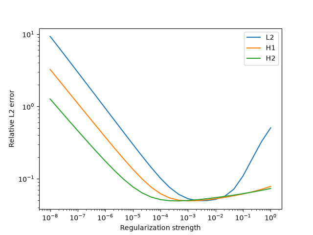

# Spectral regularization for image restoration


FFT-domain Gaussian blur, Tikhonov inversion with L2, H1 and H2 penalties, spectral cutoff and analytical bias–variance decomposition. Based on the supplied main.py and report. The original image and frequency-grid helper were missing; the new experiment uses a deterministic synthetic phantom and an explicitly documented angular-frequency grid (radians/pixel). It is a new reproducible experiment, not an exact reproduction of the report.

For transfer function K and penalty symbol P, the reconstruction multiplier is conjugate(K)/(abs(K)^2 + mu*abs(P)^2). With NumPy's FFT convention, normalized expected squared error is squared bias plus sigma^2 * sum(abs(multiplier)^2) / sum(image^2). Parameter selection uses known ground truth, an oracle benchmark rather than a deployable tuning method. Circular convolution and white Gaussian noise are assumed. The default experiment compares 25 parameters, three penalties and two target SNRs; it additionally checks the analytical risk using repeated noise draws.

## Run
```bash
python -m venv .venv
# Activate the environment for your OS, then:
pip install -r requirements.txt
python -m pytest -q
python experiment.py
```
Generated figures are in `results/`.

## Local verification
Default experiment executed successfully in the preparation environment. Output is recorded in `experiment.log`; generated artifacts are under `results/`. Runtime measurements are machine-dependent.

### Selected output



